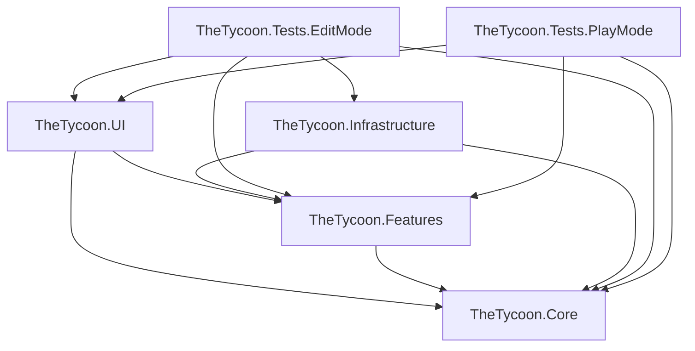

# Architecture Guide – The Tycoon

## 1. Architectural Principles

*The Tycoon* employs a modular, feature-oriented architecture adhering to clean software engineering principles:

1. **Single Responsibility Principle (SRP):** Each class owns one cohesive responsibility:
   - `FinancialLedger`: Authoritative single source of truth for company cash and monthly transaction line-items.
   - `TurnManager`: Coordinates monthly simulation calendar progression, event lifecycle, and accounting settlement.
   - `CompanyProfile`: Encapsulates corporate identity, founding date, share distribution, and valuation.
   - `EventDeckManager`: Filters eligible events, tracks cooldowns/uniques, and executes weighted selection.
   - `DecisionProcessor`: Validates choices, enacts immediate effects, and registers delayed effects.
   - `DelayedEffectScheduler`: Manages future-turn consequences and executes them on exact due dates.
   - `SimulationContext`: Unified facade routing interactions without duplicating state.
   - `DashboardPresenter`: Coordinates dashboard UI presentation and dispatches commands to simulation services.
   - `EventModalPresenter`: Formats active events into `ChoiceViewModel` lists, dispatches player decisions via `DecisionProcessor`, and gates the Advance Month button during event resolution.
2. **Data-State Separation:**
   - **Static Game Definitions:** Authored using immutable `ScriptableObject` assets (`EventDefinitionSO`, `ChoiceDefinitionSO`, `PrerequisiteConditionSO`, `ConsequenceEffectSO`).
   - **Runtime Simulation State:** Managed using pure C# plain-old-CLR-objects (POCOs) (`FinancialLedger`, `CompanyProfile`, `TurnManager`, `GameDate`, `Money`, `DelayedEffectScheduler`) that are serializable, lightweight, and unit-testable without Unity dependencies.
3. **Explicit Dependencies over Singletons:** Explicit dependency injection via constructors rather than omnipresent static singletons.
4. **Assembly Isolation:** Compile-time boundaries enforced by Unity Assembly Definition files (`.asmdef`) prevent circular dependencies and dramatically accelerate compilation.

---

## 2. Assembly Hierarchy & Dependency Boundaries



| Assembly Name | Responsibility | Allowed Dependencies |
| :--- | :--- | :--- |
| `TheTycoon.Core` | Primitive value types (`Money`, `GameDate`), service contracts (`IGameService`), base simulation models. | None (Unity Engine core only) |
| `TheTycoon.Features` | Domain simulation features: Company, Finance, Time, Events, Decisions, Characters, Employees, Investors. | `TheTycoon.Core` |
| `TheTycoon.Infrastructure` | Serialization (JSON save/load), local storage, audio service implementations, logging. | `TheTycoon.Core`, `TheTycoon.Features` |
| `TheTycoon.UI` | UI presenters (`DashboardPresenter`, `EventModalPresenter`), views (`TopBarView`, `FinancialOverviewView`, `MonthlyReportView`, `EventModalView`, `ChoiceButtonView`), bootstrapper. | `TheTycoon.Core`, `TheTycoon.Features`, `Unity.TextMeshPro`, `UnityEngine.UI` |
| `TheTycoon.Tests.EditMode` | Unit tests for domain logic, financial calculations, turn progression, event engine, and UI presenters. Includes `EventModalPresenterTests`. | `TheTycoon.Core`, `TheTycoon.Features`, `TheTycoon.Infrastructure`, `TheTycoon.UI`, `UnityEngine.TestRunner` |
| `TheTycoon.Tests.PlayMode` | Integration tests and scene lifecycle behavior. | All Assemblies, `UnityEngine.TestRunner` |

---

## 3. Directory Layout

```
Assets/
├── _Project/
│   ├── Data/
│   │   ├── Events/                 # ScriptableObject Event & Choice assets
│   │   ├── Characters/             # ScriptableObject Character archetypes
│   │   ├── Companies/              # Company industry profiles & starting templates
│   │   └── Settings/               # Game balance configuration
│   ├── Prefabs/
│   │   ├── UI/                     # Reusable UI widgets, modal windows, event cards
│   │   └── Common/
│   ├── Scenes/
│   │   ├── Bootstrap/              # Initial load scene (service resolution)
│   │   ├── MainMenu/               # Title screen, save slot selection
│   │   └── Game/                   # Main simulation scene (Game.unity)
│   ├── Scripts/
│   │   ├── Core/                   # TheTycoon.Core.asmdef
│   │   │   ├── Money.cs            # Deterministic 64-bit integer currency value object
│   │   │   ├── GameDate.cs         # Turn-based month/year progression value object
│   │   │   ├── IGameService.cs     # Lifecycle contract (Initialize / Shutdown)
│   │   │   └── ...
│   │   ├── Features/               # TheTycoon.Features.asmdef
│   │   │   ├── Company/
│   │   │   │   └── CompanyProfile.cs # Corporate identity, ownership basis points, valuation
│   │   │   ├── Finance/
│   │   │   │   ├── FinancialLedger.cs # Single source of truth for corporate cash
│   │   │   │   └── MonthlyFinancialSummary.cs # Immutable historical accounting record
│   │   │   ├── Time/
│   │   │   │   ├── TurnManager.cs  # Monthly loop coordinator and accounting settlement
│   │   │   │   └── MonthAdvancedEventArgs.cs # Monthly event payload
│   │   │   ├── Events/
│   │   │   │   ├── Conditions/     # PrerequisiteConditionSO, MinCash, Reputation, Date
│   │   │   │   ├── Effects/        # ConsequenceEffectSO, CashEffectSO, ReputationEffectSO
│   │   │   │   ├── EventDefinitionSO.cs # ScriptableObject event definition
│   │   │   │   ├── ChoiceDefinitionSO.cs # ScriptableObject choice definition
│   │   │   │   ├── DelayedEffectDefinition.cs # Configurable delayed consequence
│   │   │   │   ├── DelayedEffectScheduler.cs # Future-turn effect resolution
│   │   │   │   ├── EventDeckManager.cs # Eligibility filtering, cooldowns, weighted draw
│   │   │   │   ├── DecisionProcessor.cs # Validates choices and executes effects
│   │   │   │   └── DecisionResult.cs # Operation outcome record
│   │   │   ├── SimulationContext.cs # Unified simulation facade implementing ISimulationContext
│   │   │   └── ...
│   │   ├── Infrastructure/         # TheTycoon.Infrastructure.asmdef
│   │   │   ├── SaveSystem/         # JSON save/load serializer and file management
│   │   │   └── Logging/            # Structured logging wrappers
│   │   ├── UI/                     # TheTycoon.UI.asmdef
│   │   │   ├── Dashboard/
│   │   │   │   ├── DashboardPresenter.cs # Coordinates views & simulation events
│   │   │   │   ├── ITopBarView.cs    # Top bar interface
│   │   │   │   └── TopBarView.cs     # Header view (company, date, reputation, advance button)
│   │   │   ├── Finance/
│   │   │   │   ├── IFinancialOverviewView.cs # Financial card interface
│   │   │   │   ├── FinancialOverviewView.cs  # Cash & previous month metrics
│   │   │   │   ├── IMonthlyReportView.cs     # Report modal interface
│   │   │   │   └── MonthlyReportView.cs      # Monthly accounting settlement report modal
│   │   │   ├── Events/
│   │   │   │   ├── ChoiceViewModel.cs        # Presentation data model for a choice option
│   │   │   │   ├── IChoiceButtonView.cs      # Choice button view contract
│   │   │   │   ├── ChoiceButtonView.cs       # MonoBehaviour rendering a single choice button
│   │   │   │   ├── IEventModalView.cs        # Event modal view contract
│   │   │   │   ├── EventModalView.cs         # Event modal MonoBehaviour (card + dynamic buttons)
│   │   │   │   └── EventModalPresenter.cs    # MVP presenter for event display and decision dispatch
│   │   │   └── Bootstrap/
│   │   │       └── SimulationBootstrapper.cs # Explicit composition root in Game.unity
│   │   └── Editor/                 # TheTycoon.Editor.asmdef
│   │       ├── GameSceneBuilder.cs           # Programmatic scene and UI hierarchy construction
│   │       └── SampleEventAssetCreator.cs    # Generates sample event ScriptableObject assets
│   └── Tests/
│       ├── EditMode/               # Fast, pure unit tests (107 tests)
│       └── PlayMode/               # Component integration tests
```

---

## 4. Key Architectural Patterns

### Money & Precision
Floating-point numbers (`float`, `double`) are strictly prohibited for financial operations. Currency is represented by `Money`, a 64-bit `long` value struct representing minor units (sen/cents):
- Arithmetic operations are checked against integer overflow.
- Default formatting displays Malaysian Ringgit (`RM250,000.00`) with configurable symbol and decimal precision.

### Simulation Orchestration & State Integrity
- `TurnManager` advances the simulation turn-by-turn. It enforces that mandatory business events are resolved before month completion, triggers `DelayedEffectScheduler.ProcessDueEffects()`, calls `FinancialLedger.SettleMonthlyAccounts()`, increments `GameDate`, and dispatches `OnMonthAdvanced`.
- `CompanyProfile` maintains equity in basis points (10,000 bps = 100.00%), eliminating rounding inaccuracies.
- Cash is exclusively managed by `FinancialLedger`. No duplicate cash balances exist in the event engine or company profile.
- `SimulationContext` serves as a facade implementing `ISimulationContext` without holding duplicate state.
