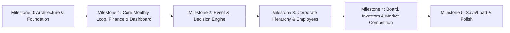

# Development Roadmap – The Tycoon

## 1. Overview & Phased Progression

The development of *The Tycoon* is organized into clear, test-driven phases. Each milestone delivers working, verifiable game systems.

---

## 2. Milestone Breakdown

### Milestone 0: Initialization & Architecture
- **Status:** Completed
- **Deliverables:**
  - Audited existing project assets and settings.
  - Established clean folder structure under `Assets/_Project/`.
  - Configured root namespace `TheTycoon` and `.editorconfig`.
  - Authored comprehensive architectural specifications and system designs.
  - Defined modular `.asmdef` boundaries (`Core`, `Features`, `Infrastructure`, `UI`, `Tests`).
  - Implemented overflow-safe immutable value types (`Money`, `GameDate`).
  - Verified 100% zero-error compilation and passing EditMode tests.

### Milestone 1: Turn-Based Monthly Loop, Finance & Dashboard UI
- **Status:** Completed
- **Deliverables:**
  - [x] `FinancialLedger`: Authoritative cash manager, revenue/expense recording, net profit/loss calculation.
  - [x] `MonthlyFinancialSummary`: Immutable completed period accounting retention.
  - [x] `TurnManager`: Monthly turn advancing, date increments, settlement orchestration, resilient event dispatch.
  - [x] `CompanyProfile`: Corporate name, founding date, basis points equity allocation, valuation representation.
  - [x] `SimulationContext`: Unified facade routing systems without state duplication.
  - [x] `DashboardPresenter`: Model-View-Presenter presentation coordinator with event subscriptions.
  - [x] `TopBarView`: Corporate header displaying company name, date, reputation, and Advance Month button.
  - [x] `FinancialOverviewView`: Financial metrics card displaying cash balance and prior month revenue/expense/net.
  - [x] `MonthlyReportView`: Modal dialog displaying completed monthly accounting settlement.
  - [x] `SimulationBootstrapper` & `Game.unity`: Scene composition root wiring domain dependencies.

### Milestone 2: Event & Decision Engine
- **Status:** Completed ✅
- **Deliverables:**
  - [x] ScriptableObject schema: `EventDefinitionSO`, `ChoiceDefinitionSO`, `PrerequisiteConditionSO`, `ConsequenceEffectSO`.
  - [x] Reusable conditions: `MinimumCashConditionSO`, `ReputationConditionSO`, `DateConditionSO`.
  - [x] Reusable effects: `CashEffectSO`, `ReputationEffectSO`.
  - [x] `EventDeckManager`: Event draw pipeline, prerequisite validation against game state, weights, cooldowns, and unique triggers.
  - [x] `DecisionProcessor`: Choice validation, immediate consequence application, and delayed effect registration.
  - [x] `DelayedEffectScheduler`: Turn-based future-consequence scheduling and exact-date resolution.
  - [x] Monthly lifecycle integration: Month Ready, Event Pending (blocking unresolved mandatory events), Month Completion.
  - [x] **Event Modal UI**: Corporate-styled 2D card, narrative text, `EventModalPresenter` with `ChoiceViewModel`, dynamic `ChoiceButtonView` buttons with requirement hints and consequence previews.
  - [x] **Dashboard Integration**: Advance Month button blocked while mandatory event is unresolved; event modal shown after monthly report dismissed.
  - [x] **Sample Event Assets**: Three canonical ScriptableObject events (`EVT_MAJOR_CLIENT`, `EVT_EMPLOYEE_RETENTION`, `EVT_MARKET_EXPANSION`) with conditions and delayed consequences.
  - [x] **SampleEventAssetCreator**: Editor utility to regenerate sample assets via `TheTycoon/Create Sample Event Assets`.
  - [x] Comprehensive EditMode tests (111 passing tests).

### Milestone 3: Characters & Executive Management
- **Dependencies:** Milestone 2
- **Deliverables:**
  - Executive roles: CFO, COO, CMO, CTO, HR Director.
  - Character stats: Competence, Loyalty, Ambition, Stress.
  - Department management: Staff headcount, salary levels, operational efficiency.
  - Executive interactions and loyalty-driven events.

### Milestone 4: Board of Directors, Investors & Market Competition
- **Dependencies:** Milestone 3
- **Deliverables:**
  - Board approval meter and shareholder confidence.
  - Funding rounds (Seed, Series A, B, IPO) and equity dilution.
  - AI Competitor profiles and market share dynamics.
  - Hostile takeovers and acquisition opportunities.

### Milestone 5: Save/Load System, Audio & Final Release Polish
- **Dependencies:** Milestone 4
- **Deliverables:**
  - Robust JSON-based state serializer and multi-slot save manager.
  - Sound effects (clicks, coins, signature corporate alerts) and ambient audio tracks.
  - End conditions (Bankruptcy, Triumph, Forced resignation by board).
  - Standalone Windows x64 build and validation.
