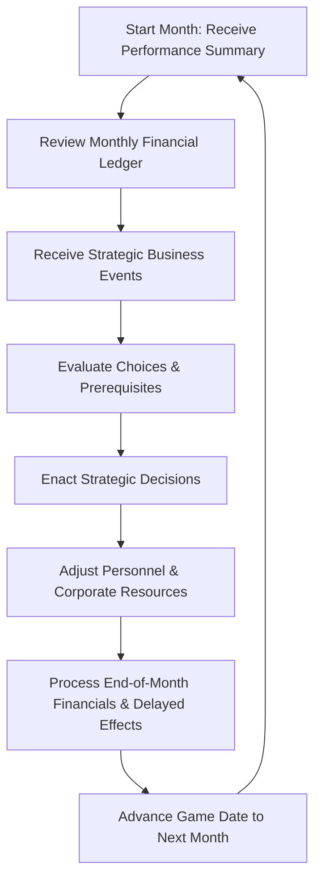

# Project Brief – The Tycoon

## 1. Executive Summary

**The Tycoon** is a single-player 2D business management strategy simulation game built with Unity 6 (URP 2D) and C#. In the game, the player assumes the role of a company founder and CEO, steering an enterprise from a modest venture into an influential corporate empire through turn-based monthly decision-making.

Combining event-driven strategic dilemmas reminiscent of *Crusader Kings III* with the sharp, accessible consequence evaluation of *Reigns* and systemic depth of corporate business simulations, *The Tycoon* challenges players to balance finances, human relationships, investor expectations, board dynamics, and market conditions.

---

## 2. Product Identity & Platform

- **Project Name:** The Tycoon
- **Genre:** Business Strategy Simulation, Event-Driven Narrative Strategy, Corporate Management
- **Platform:** Windows PC (Offline Desktop)
- **Engine Version:** Unity 6 (6000.6.10f1)
- **Rendering Pipeline:** Universal Render Pipeline (URP 2D)
- **Programming Language:** C# (C# 9.0+ / .NET Standard 2.1)
- **Code Editor:** Visual Studio Code (C# DevKit / OmniSharp)
- **Distribution Model:** Single-player, offline standalone desktop application

---

## 3. Visual & Aesthetic Direction

- **Visual Style:** 2D clean corporate and illustrated interface.
- **Environments:** Corporate headquarters, executive boardrooms, corner offices, press rooms.
- **Characters:** High-contrast expressive 2D character portraits for executives, board members, investors, union representatives, and competitors.
- **UI & Presentation:** Crisp, professional management dashboards, ledger sheets, decision prompt cards with clear requirement indicators and consequence previews.

---

## 4. Gameplay Loop

The core monthly loop progresses turn by turn:

1. **Monthly Review:** Review previous month's operational performance, cash flow, revenue, and executive satisfaction.
2. **Event Delivery:** Receive scripted and dynamically weighted random business events (macroeconomic shifts, workplace crises, product dilemmas, competitor moves).
3. **Decision & Strategy:** Evaluate options based on requirements (capital, reputation, board approval, executive loyalty).
4. **Operations & Allocation:** Allocate capital, adjust workforce, manage investor sentiment, or service debt.
5. **Simulation Settlement:** Calculate profit/loss, update valuation, apply immediate and delayed consequences, and advance the calendar.

---

## 5. Confirmed vs. Unconfirmed Design Decisions

### Confirmed Decisions
- **Turn Granularity:** Discrete monthly turns (Year/Month).
- **Architecture:** Feature-based modular architecture using Unity Assembly Definitions (`asmdef`).
- **Precision:** Financial calculations use integer-based fixed-point representation (`Money` struct based on 64-bit integer cents) to eliminate floating-point drift.
- **Event Architecture:** Data-driven `ScriptableObject` definitions for events, requirements, and consequences, decoupled from runtime state.
- **Persistence:** Local JSON-based serialization for offline game state save/load.

### Unconfirmed Decisions (Configurable / TBD)
- **Starting Industry:** Tech, Manufacturing, Pharmaceutical, or Multi-Industry Conglomerate (Architecture supports configurable industry definitions via ScriptableObjects).
- **Historical Era:** Modern day (2020s), 1980s corporate boom, or configurable era templates.
- **End Conditions / Victory Criteria:** Market capitalization target, IPO exit, monopoly buyout, or endless sandbox.
- **Audio Assets:** Music theme composition and sound effect design remain TBD.
