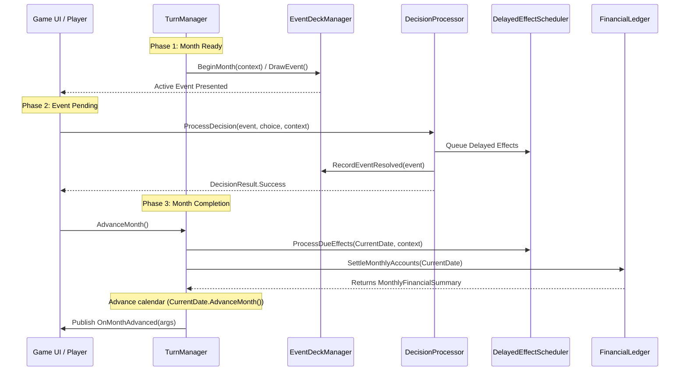

# System Design – The Tycoon

## 1. Monthly Turn Progression & Time System

The game simulation operates on a turn-based monthly loop coordinated by `TurnManager`.

### Monthly Lifecycle Phases
The simulation structures each month into three deterministic phases:

1. **Month Ready:**
   - The player reviews current corporate treasury and operational performance.
   - An eligible event is drawn from `EventDeckManager` and presented if available.
2. **Event Pending:**
   - The player evaluates available choices and requirements.
   - If an event is mandatory, `TurnManager.AdvanceMonth()` will block turn completion until `DecisionProcessor.ProcessDecision()` is successfully executed.
3. **Month Completion:**
   - `DelayedEffectScheduler.ProcessDueEffects(CurrentDate, context)` executes any consequences due for the current month.
   - `FinancialLedger.SettleMonthlyAccounts(CurrentDate)` computes net profit/loss and updates cash reserves.
   - `CurrentDate = CurrentDate.AdvanceMonth()` advances the calendar.
   - `OnMonthAdvanced` event notification is published to subscribers with `MonthAdvancedEventArgs`.
   - Next month's event opportunity is prepared.

### Event Notification Resilience
- `MonthAdvancedEventArgs` carries `CurrentDate` (the new active month) and `SettledSummary` (the completed financial summary of the elapsed month).
- `TurnManager.OnMonthAdvanced` safely isolates subscriber invocations. If any subscriber throws an exception, remaining subscribers are still notified, and an `AggregateException` is raised after all invocations complete.
- Re-entrant advancement requests during an active transition throw `InvalidOperationException`.

---

## 2. Event & Decision Engine Architecture

The event engine drives narrative strategy inspired by *Crusader Kings III* and *Reigns*.

### Static Definitions (`ScriptableObject`)
- `EventDefinitionSO`:
  - `string EventId`: Unique identifier (e.g., `EVT_FIN_001_AUDIT`).
  - `string Title` & `Description`: Narrative presentation.
  - `EventCategory Category`: Enum (`Financial`, `Workforce`, `Legal`, `Market`, `Executive`, `Corporate`).
  - `int Weight`: Selection probability weight (default 100).
  - `bool IsUnique`: If true, event can only be resolved once per playthrough.
  - `int CooldownMonths`: Minimum months that must elapse before event can reoccur.
  - `PrerequisiteConditionSO[] Prerequisites`: Conditions required for event eligibility.
  - `ChoiceDefinitionSO[] Choices`: Available decisions (minimum 1 required).

- `ChoiceDefinitionSO`:
  - `string ChoiceId` & `ChoiceTitle` & `ChoiceDescription`.
  - `PrerequisiteConditionSO[] Requirements`: Requirements to select this option.
  - `ConsequenceEffectSO[] ImmediateEffects`: Executed immediately upon selection.
  - `DelayedEffectDefinition[] DelayedEffects`: Consequences scheduled to trigger $N$ months later.

### Reusable Conditions & Effects
- **Conditions (`PrerequisiteConditionSO : ScriptableObject, ICondition`):**
  - `MinimumCashConditionSO`: Requires `CurrentCash >= RequiredCash`.
  - `ReputationConditionSO`: Requires `CorporateReputation` within specified range.
  - `DateConditionSO`: Restricts availability by `MinimumDate` and optional `MaximumDate`.
- **Effects (`ConsequenceEffectSO : ScriptableObject, IEffect`):**
  - `CashEffectSO`: Adjusts cash reserves via `context.ModifyCash(delta)`.
  - `ReputationEffectSO`: Adjusts reputation via `context.ModifyReputation(delta)`.

### Event Deck Management (`EventDeckManager`)
- Evaluates candidate events against `ISimulationContext`.
- Excludes unique events that were previously resolved.
- Enforces active cooldowns (`CurrentDate < AvailableDate`).
- Performs weighted random selection via injectable `IRandomProvider` (enabling deterministic unit testing).

### Decision Processing (`DecisionProcessor`)
- Verifies that target event is active in `EventDeckManager`.
- Verifies that choice belongs to active event.
- Validates that choice requirements are satisfied.
- Enacts immediate effects.
- Schedules delayed effects into `DelayedEffectScheduler`.
- Marks event as resolved and clears active event.
- Returns explicit `DecisionResult` (`IsSuccess`, `ErrorMessage`).

---

## 2a. Event Modal UI Architecture

The Event Modal integrates the event engine with the player interface through a strict MVP pattern.

### Component Overview
| Component | Role |
| :--- | :--- |
| `ChoiceViewModel` | Pure C# data model; decouples rendering from domain entities |
| `IChoiceButtonView` / `ChoiceButtonView` | MonoBehaviour; renders one choice option with title, description, requirements hint, and consequence previews |
| `IEventModalView` / `EventModalView` | MonoBehaviour; renders the full event card with dynamic choice button pool |
| `EventModalPresenter` | Pure C# presenter; maps `EventDefinitionSO` to `ChoiceViewModel` list, dispatches decisions, fires `OnEventResolved` |

### Coordination with DashboardPresenter
- `DashboardPresenter.RefreshAll()` calls `SetAdvanceButtonInteractable(!context.TurnManager.HasPendingMandatoryEvent)`.
- Advance Month button is **disabled** while `EventDeckManager.HasActiveEvent` is true.
- When the Monthly Report is dismissed, `DashboardPresenter.HandleDismissReportClicked()` checks for a pending event and calls `EventModalPresenter.PresentActiveEvent()`.
- When `EventModalPresenter.OnEventResolved` fires, `DashboardPresenter.HandleEventResolved()` calls `RefreshAll()` which re-enables the advance button.

### Choice Consequence Preview
`EventModalPresenter.PresentEvent()` builds each `ChoiceViewModel` with:
- `ImmediateConsequences`: `IEffect.Description` for each `ImmediateEffect`.
- `DelayedConsequences`: `"In N month(s): {Effect.Description}"` for each `DelayedEffectDefinition`.
- `RequirementHint`: First failing `ICondition.GetFailureReason(context)` if `CanSelect()` returns false.

### Sample Event Assets
Three canonical event ScriptableObject assets are generated by `SampleEventAssetCreator`:
| Asset | ID | Category | Key Mechanic |
| :--- | :--- | :--- | :--- |
| `Event_01_MajorClient` | `EVT_MAJOR_CLIENT` | Financial | Accept contract for +RM75,000 / decline for no cost |
| `Event_02_EmployeeRetention` | `EVT_EMPLOYEE_RETENTION` | Workforce | Pay RM25k bonus +10% rep (requires RM30k) or lose -15% rep |
| `Event_03_MarketExpansion` | `EVT_MARKET_EXPANSION` | Market | Invest RM50k (requires RM60k) for delayed +RM100k and +10% rep in 3 months |

### Delayed Consequences (`DelayedEffectScheduler`)
- Supports scheduling consequences $N$ calendar months in the future.
- **Timing Rule:** `DueDate = CurrentDate.AdvanceMonths(delayMonths)`.
- Effects remain pending in queue until `TurnManager` completes the month where `CurrentDate >= DueDate`.
- Completed effects execute once and are safely purged from the queue.

---

## 3. Company Profile & Share Ownership

`CompanyProfile` represents corporate identity, ownership structure, and corporate valuation. It is completely independent of Unity UI and does not maintain duplicate cash balances.

### Identity & Validation
- `CompanyName`: Validated non-empty string with controlled renaming via `Rename(string newName)`.
- `FoundingDate`: Immutable `GameDate` recording establishment.

### Share Ownership via Basis Points
Share ownership uses integer basis points to eliminate floating-point representation drift:
- **Total Equity Pool:** Exactly `10,000` basis points ($100.00\%$, where $1\text{ bp} = 0.01\%$).
- **Allocation Rules:**
  - Basis points per shareholder must be $\ge 0$.
  - Total allocated basis points across all shareholders cannot exceed $10,000$.
  - Unallocated equity is tracked via `UnallocatedBasisPoints = 10,000 - TotalAllocatedBasisPoints`.
  - Setting a shareholder's allocation to $0$ removes them from the shareholder registry.

### Corporate Valuation
- Stored as `Money` in `CompanyProfile.Valuation`.
- Separate from company cash.
- Initialized and updated via `SetValuation(Money newValuation)`. Cannot be negative.
- *Note:* A formal dynamic valuation formula (based on EBITDA multiples, DCF, or market capitalization) remains TBD and will be introduced in a future milestone.

---

## 4. Financial System

### Single Source of Truth
All cash flow is governed by `FinancialLedger`.
- **Active Transactions:** Recorded as `LedgerEntry` items (`Revenues` and `Expenses`).
- **Settlement:** `SettleMonthlyAccounts(GameDate period)` computes `OpeningCash`, `TotalRevenue`, `TotalExpenses`, `NetProfit`, and `ClosingCash`.
- **History Preservation:** Generates an immutable `MonthlyFinancialSummary` appended to `History` and `LatestSummary`. Active monthly lines are cleared for the next month.
- **Duplicate Guard:** Settlement rejects duplicate or past periods with `InvalidOperationException`.

---

## 5. Save & Persistence Architecture

- **Format:** Strongly-typed JSON files saved locally in `Application.persistentDataPath/Saves/`.
- **Payload (`SaveData`):**
  - Company profile (name, founding date, valuation, shareholder allocations).
  - Financial ledger state (current cash, historical monthly summaries).
  - Current calendar date.
  - Event history (resolved event IDs, active cooldown dates, pending delayed effects).
